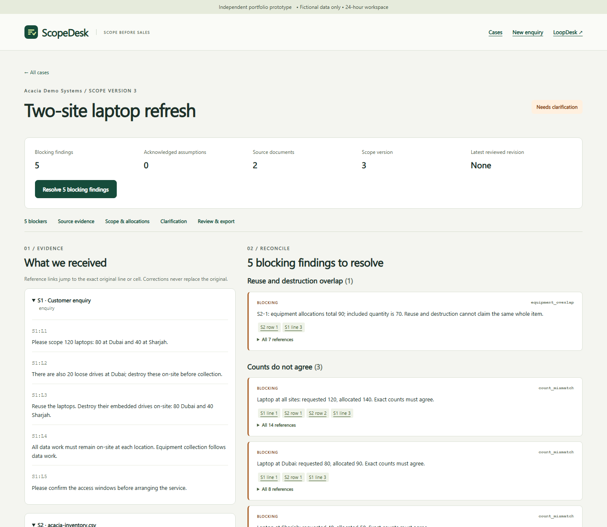
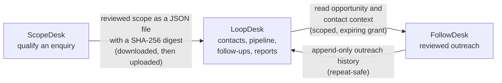

# ScopeDesk

Source-linked IT asset-disposition enquiry qualification: keep the customer's enquiry, map the CSV inventory, reconcile the scope, draft precise clarification questions and hand a reviewed revision to LoopDesk.

**Live demo:** <https://scopedesk-chi.vercel.app>. Choose **Open demo workspace** for a private 24-hour workspace with two worked cases and three more examples you can load; no sign-up. One of three connected apps: **ScopeDesk** qualifies an enquiry, [LoopDesk](https://github.com/f20230125-sudo/loopdesk) tracks it ([live](https://loopdesk-sigma.vercel.app)) and [FollowDesk](https://github.com/f20230125-sudo/followdesk) follows up ([live](https://followdesk-phi.vercel.app)).

[](https://github.com/f20230125-sudo/scopedesk/actions/workflows/checks.yml) [](https://github.com/f20230125-sudo/scopedesk/actions/workflows/live-smoke.yml)

**Stack:** Python (Flask) and Jinja, a small SQL repository layer with forward-only migrations, SQLite locally and PostgreSQL (Neon) when hosted, no frontend build step. Hosted on Vercel and Neon, both on free plans.

Independent synthetic-data portfolio prototype. Its workflow is a researched proposal, not a claim about Madenat's current systems, approval, adoption or measured business improvement. Use fictional details only. No live AI, pricing, valuation, certificates, legal-compliance scoring, disposal-method recommendations, plant operations, PDF/OCR or XLSX ingestion.



## How the three apps fit together

Each app has its own server, database and session cookie. They are joined only by two narrow, explicit contracts.



The scope handoff creates or updates one opportunity and never overwrites CRM fields. FollowDesk's grant comes from a one-use pairing code created in LoopDesk; it cannot create CRM records or change stage, owner, value, next action or tasks.

## Run locally on Windows

Open **`D:\codex\scopedesk\Start-ScopeDesk.cmd`**, then visit **http://127.0.0.1:5058**. Open **`D:\codex\loopdesk\Start-LoopDesk.cmd`** separately for the CRM on **http://127.0.0.1:5055**. The launchers apply pending migrations. Both applications work independently; only the JSON handoff joins them.

The offline archive includes both applications and cached runtime/test wheels for the existing **Windows x64 / Python 3.14** installation. Extract to D:, then open each launcher. It does not install Python. All new environments, caches, databases, temporary files and artifacts stay under the extracted folders on D:. No browser download or frontend build is needed to use either app. Automated browser verification uses an existing Playwright installation and Chromium separately.

For a source checkout with Python 3.12+:

```powershell
cd D:\codex\scopedesk
$env:TEMP = 'D:\codex\scopedesk\.local\temp'
$env:TMP = $env:TEMP
$env:PYTHONPYCACHEPREFIX = 'D:\codex\scopedesk\.local\pycache'
New-Item -ItemType Directory -Force $env:TEMP | Out-Null
python -m venv .venv
.venv\Scripts\python -m pip install -r requirements-dev.txt
.venv\Scripts\python scripts\manage.py run
```

Use `--no-index --find-links .local/wheels` with pip for an extracted offline package. Runtime dependencies, including transitive dependencies, are pinned in `requirements.txt`; tests are pinned in `requirements-dev.txt`. Local SQLite and the persistent random session secret live in ignored `instance/`. Production requires `SCOPEDESK_DATABASE_URL` with PostgreSQL and a random `SCOPEDESK_SECRET_KEY` of at least 32 characters. `.env.example` documents process settings; it is never silently loaded.

## Worked demonstration

1. Open the demo workspace and **Two-site laptop refresh**. The customer requests 120 laptops (80 Dubai, 40 Sharjah), 20 loose drives, equipment reuse and on-site media destruction. The inventory totals 120 laptops but has 70/50 by site. A mistaken whole-equipment destruction allocation and an off-site loose-drive action add conflicts.
2. Follow findings to the source evidence. Review stays disabled while conflicts remain. Download or edit the fixed-template clarification draft; no message is sent.
3. Expand **Fictional customer clarification for this demonstration**, use the supplied text and **Record source statement**. It becomes an immutable customer-clarification source.
4. Choose **Load worked correction**. This fills the structured form for inspection. **Save scope & recalculate** applies the corrections through the same service as manual edits. Original inventory cells stay unchanged.
5. **Review & create revision**. Inspect the brief, print it or download standalone HTML and the reviewed JSON. The other seeded case independently demonstrates valid equipment reuse with embedded-drive destruction.
6. In LoopDesk, start its demo, open **Scope import**, upload the JSON, preview scope and select existing organisation/contact records and an owner. Confirm. Repeating the same latest revision returns the same opportunity; newer revisions attach history while preserving CRM fields.

On the cases page, **Load another example** offers three additional fictional enquiry/CSV pairs. **Approximate monitor count** requests about 200 monitors against 192 listed: acknowledge the difference and record a count basis before review. **Repeated identifiers in a laptop register** retains `000042`, `000042` and `000007` until a duplicate decision is recorded. **Monitor list supplied in boxes** stays blocked until a source-linked item-count/unit correction is saved. Tests pin each example's exact finding codes and source labels. Reopening a loaded example uses its existing case; examples consume the same 20-case workspace quota as manual cases, with the remaining capacity shown on the page.

Each case now shows blocking findings, acknowledged assumptions, source-document count, scope version and the latest reviewed revision, with a link to the next review step. Findings are grouped by code under plain-English titles. Compact row/line links expand through native **All N references** disclosures; exact references remain in the clarification draft and exports. Original CSV records have minimum column widths, a labelled keyboard-scrollable region, a scroll hint and a sticky Record column. These features work without JavaScript; corrections use the existing JSON fallback when JavaScript is disabled. The existing 32-reference limit per computed finding and its overflow notice are retained; original allocation/source evidence is unchanged.

The workflow is designed for an approximately five-minute review. No human completion-time study was performed. [Captioned 60–90 second recording](artifacts/ScopeDesk-Demo.webm) and [chapter timings](artifacts/demo-chapters.json) show the actual local workflow with synthetic data.

## Manual cases and review rules

Create a case, paste the original enquiry (32 KiB maximum), then import UTF-8 CSV. Explicitly select asset register (one item per row) or quantity list (stated counts), and comma, semicolon or tab. Map columns, preview the interpretation, then confirm the exact previewed mapping. Limits are 256 KiB, 1,000 records, 20 columns and 4 KiB per cell. The app preserves raw text, every logical record and original identifiers including leading zeros. Missing/invalid quantities stay unknown rather than zero. Blank records are retained. Duplicate/empty headers, encoding errors and oversized fields produce clear rejections.

Confirm counts and restrictions explicitly from the enquiry. There is no free-text AI extraction: the reviewer decides which lines support a requirement. Add equipment allocations separately from media actions. Quantity-list rows may be split across sites and outcomes; child quantities must conserve the included parent count. Embedded-media counts are entered independently. Overall totals do not override per-site requirements. Exact mismatches block; approximate differences require acknowledgement and an explicit count basis, exported as an assumption.

On-site data restrictions conflict with off-site wipe/destruction or collection before the required work. Collection afterwards is allowed. Duplicate identifiers require a recorded review decision; they are never auto-merged or deleted. Correct or exclude source rows using an immutable statement/clarification, reason and references. Exclusions retain the original input and require their allocations to be removed explicitly. Unsupported units and unclear categories remain blocking findings until corrected.

All edits require a decision note and a version. Stale saves fail without writing. Every confirmed requirement, allocation, assumption and correction must resolve to a source line or CSV cell. Origin labels distinguish enquiry/CSV facts from customer clarifications, reviewer statements and assumptions. A resolvable citation is not automatic proof that the cited text supports the claim; semantic review remains the salesperson's responsibility.

Statuses progress through **Needs clarification → Ready for review → Reviewed / Reviewed with assumptions**. Review freezes state, sources and findings. Any later edit invalidates that review, and historical briefs display **Superseded**. Fresh CRM handoff downloads are denied for superseded revisions. Historical reviewed allocation CSVs remain available with their revision label; draft exports are clearly labelled. The downloadable HTML includes its own styles and remains readable offline.

## Verification

```powershell
.venv\Scripts\python scripts\manage.py test
# Both servers must be running for the real browser journey:
.venv\Scripts\python scripts\manage.py browser
.venv\Scripts\python scripts\manage.py record
```

`tests/fixtures.json` contains 24 authored domain cases, eight valid, eight conflicting and eight boundary, with expected findings and exact source labels fixed before final UI verification. Additional checks cover import boundaries, references, immutable reviews, stale edits, rollback, workspace isolation, expiry, CSRF, HTML escaping, safe CSV and restart persistence. LoopDesk retains its original 51 checks and adds importer coverage. [Verification report](docs/verification.md) separates SQLite, PostgreSQL and hosted results.

Browser scripts default to the existing workspace installation at `D:/codex/rx-market-pulse/dashboard/package.json`; set `SCOPEDESK_BROWSER_PACKAGE` to a package path containing the pinned Playwright/axe dependencies elsewhere. Set `SCOPEDESK_URL` and `LOOPDESK_URL` for other local endpoints. Browser artifacts include screenshots, print rendering, actual downloaded briefs and handoffs, accessibility reports and recorded checks. Automated accessibility scans are limited to detectable issues and do not establish full accessibility conformance.

For ScopeDesk-only verification, set `$env:SCOPEDESK_ONLY = '1'` before `scripts/manage.py browser`. This keeps ScopeDesk's review/export checks and runs the additional example, summary, source-table and no-JavaScript journeys, while recording that LoopDesk import was not run. The default browser output is now `artifacts/browser-check-2026-10-27/`; override it with `SCOPEDESK_ARTIFACTS`. New evidence includes 1440×900 and 390×844 viewport captures of every changed page, 1024-pixel case/source captures, and an A4 print PDF. Before captures are in `artifacts/improvement-before-2026-10-27/`. The 24 authored domain fixtures in `tests/fixtures.json` remain unchanged; new service/HTTP assertions are in `tests/test_improvements.py`. Test-runner caches now use `.local/pytest-cache`.

For a dedicated PostgreSQL test database, set `SCOPEDESK_TEST_DATABASE_URL`, then run `scripts/manage.py test-postgres`. Each DB fixture creates and drops only a unique `scopedesk_test_*` schema. LoopDesk uses `LOOPDESK_TEST_DATABASE_URL` and unique `loopdesk_test_*` schemas. Both apps now pass their PostgreSQL CI suites; exact commits and run evidence are in `artifacts/ci-verification.json`. Production Neon connectivity and hosted HTTPS still require verification.

## Architecture and handoff

Python/Flask, Jinja, lightweight JavaScript/CSS, SQLite locally and a psycopg repository path for hosting. No frontend build. Versioned SQL migrations and validated JSON case aggregates share the same service layer across HTTP handlers and tests. See [architecture](docs/architecture.md) and [version-one handoff contract](docs/handoff-v1.md).

The 48 KiB handoff carries grouped scope, review identity/time, assumptions, actions and source-reference labels/origins. Original documents and full serial registers are excluded. SHA-256 canonical-payload checking provides integrity, not authenticity. Import mappings are workspace-scoped. Offline import cannot detect an unseen newer revision or revoke a file already saved to disk.

Each application has an isolated signed-cookie 24-hour workspace. Expiry is checked on protected routes; physical cleanup happens on a subsequent workspace creation. ScopeDesk's cookie name is `scopedesk_session`; LoopDesk retains `session`. Reset starts a new workspace. This is a portfolio demonstration rather than a production system with durable staff accounts, backups, monitoring or a real-customer access model.

## Hosting and materials

**Hosted** at <https://scopedesk-chi.vercel.app> on Vercel's free Hobby plan with a Neon PostgreSQL database on Neon's free plan, separate from LoopDesk's. See the [deployment runbook](docs/deployment.md). `python scripts/live-smoke.py` checks the hosted app (health, security headers, cookie flags, main pages, 404) and a weekly GitHub Actions workflow runs it; the browser journey can be pointed at the hosted app with `SCOPEDESK_URL` (see [verification](docs/verification.md)). Neon suspends an idle database, so the first request after a quiet period can be slower.

Domain research was supplied in the approved plan: Madenat's public [ITAD](https://madenatrecycling.ae/itad-management-uae) and [data-security service](https://madenatrecycling.ae/data-disposal-services-dubai) pages. The proposed workflow does not claim knowledge of its internal processes. Personal application material lives in ignored `private/` folders and is excluded from public source and runtime packages.

## Checkpoint history

Newest first, kept as written. Entries dated 26 October 2026 describe the state before the apps were hosted; the hosting section above is current.

Local improvement verification, 27 October 2026: **127 tests pass on SQLite**, including 27 new example, presentation, boundary and client-address checks. **79 local Chromium checks pass**, with 22 accessibility scans and zero detected violations. Afterwards the hosted deployment passed the same journey on PostgreSQL (79 checks, 22 axe scans, no violations; smoke 12/12), and FollowDesk's hosted three-app journey covers the cross-app import. See [the improvement report](artifacts/improvement-report-2026-10-27.md) and [new browser evidence](artifacts/browser-check-2026-10-27/browser-verification.json). Earlier checkpoints below remain historical.

Python dependency follow-up: the [three-app advisory scan](https://github.com/f20230125-sudo/followdesk/actions/runs/40379579882) checked all 20 pinned runtime/test packages, including conditional platform pins, and reported no known vulnerabilities. The hosted apps are verified separately: see [verification](docs/verification.md).

Latest checkpoint, 26 October 2026: **100 checks pass on SQLite and PostgreSQL in [Linux CI](https://github.com/f20230125-sudo/scopedesk/actions/runs/40376473352)**, including hosted CRM-link configuration. Vercel project creation/linking is complete; no application is deployed. Production navigation uses the validated `SCOPEDESK_LOOPDESK_URL` and has no localhost default. Earlier counts below describe prior checkpoints. See [deployment status](docs/deployment.md).

Security review, 26 October 2026: **92 automated checks pass**. Fixed oversized-integer crashes, production configuration gaps, reset-cookie replay and resource accumulation; added host/origin checks, persistent request limits and atomic quotas. The 40-check attack browser journey and both original browser workflows pass locally. See [security report](https://github.com/f20230125-sudo/loopdesk/blob/main/docs/security-review/README.md). Production now requires explicit `SCOPEDESK_TRUSTED_HOSTS` in addition to PostgreSQL and a random session secret. Reset revokes the previous workspace cookie; retained data awaits expiry cleanup. Earlier release counts below are historical.
